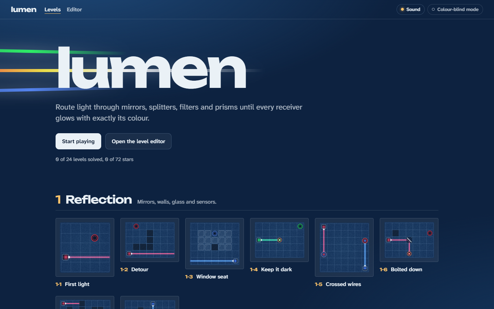
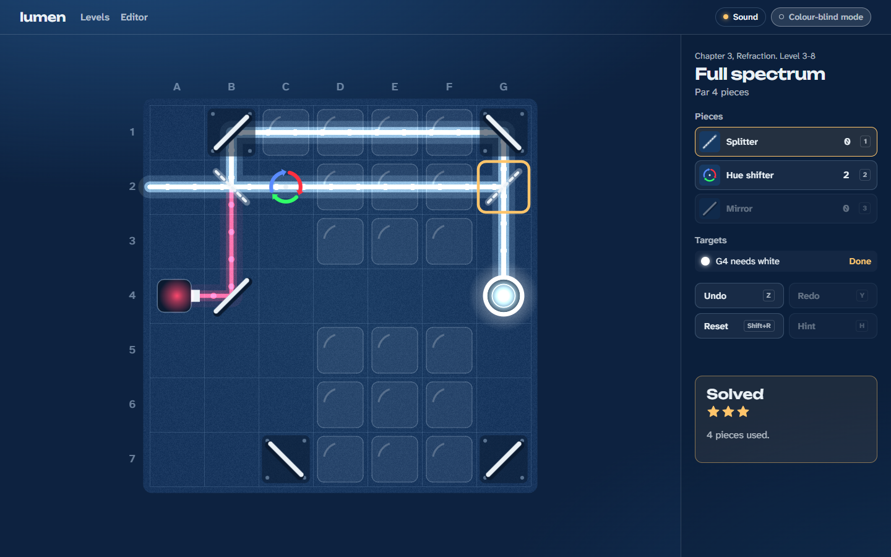
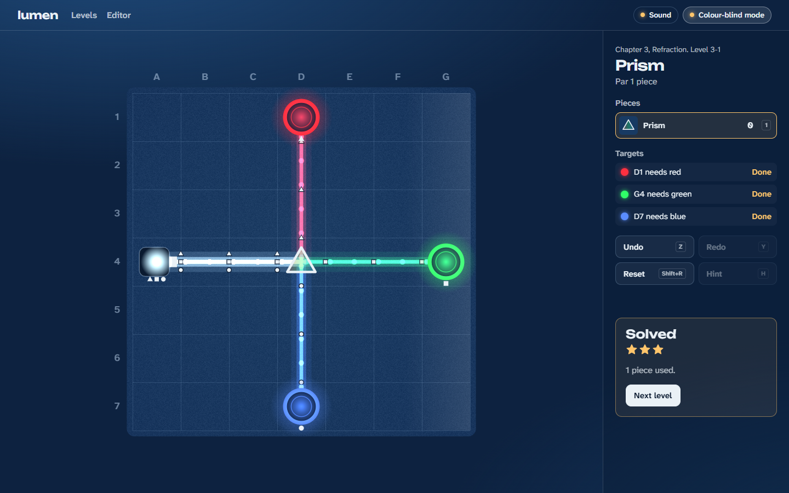
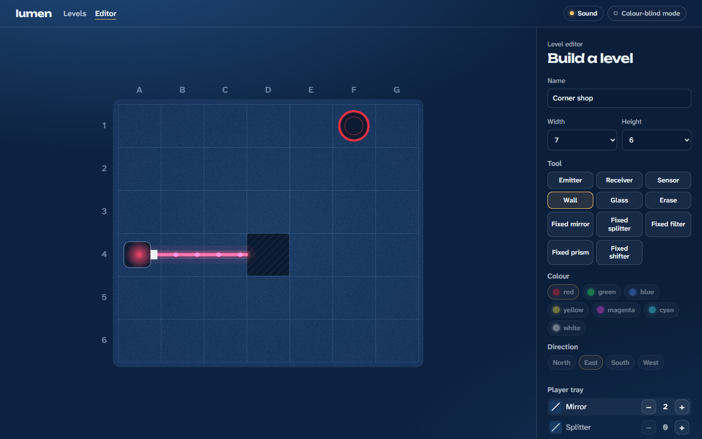
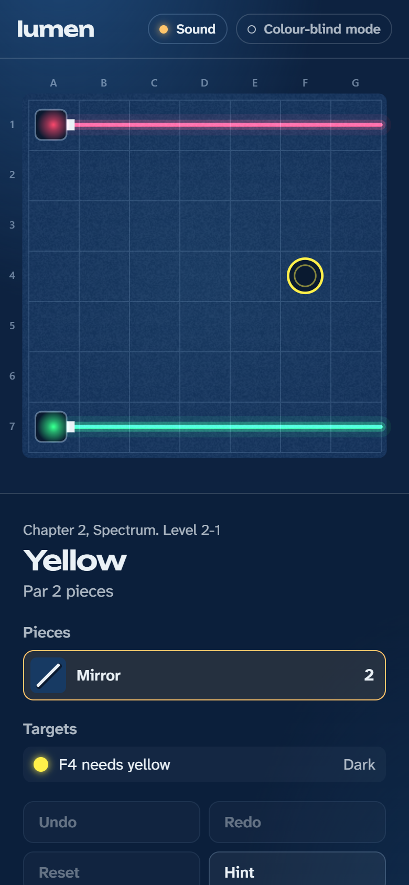
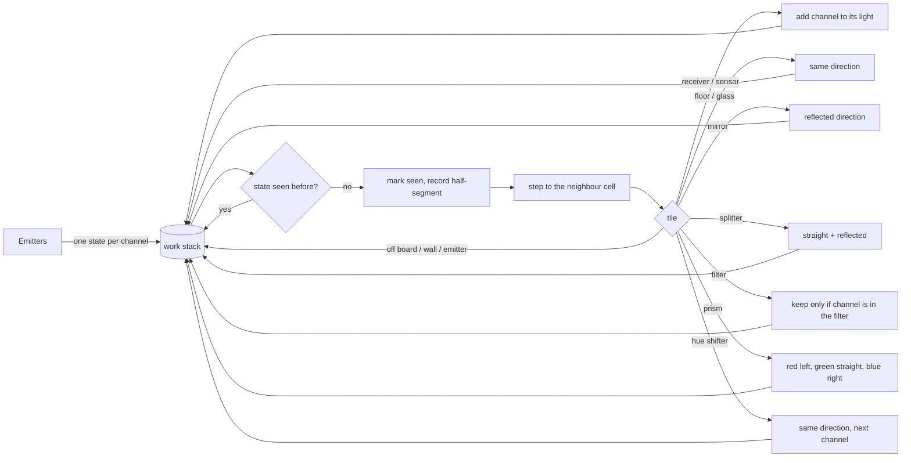
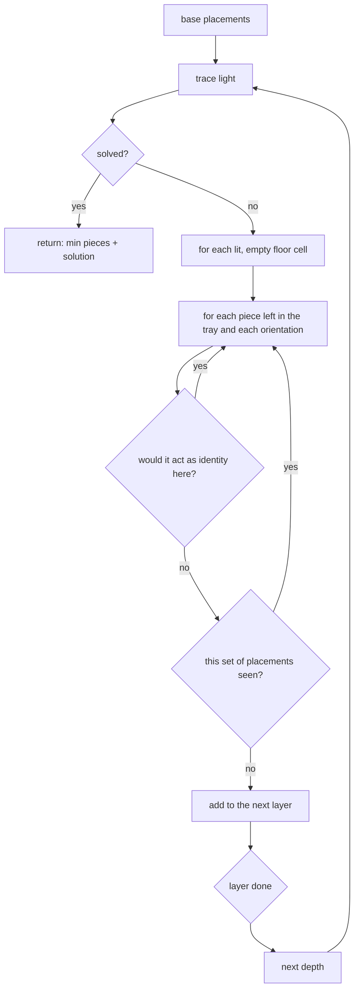
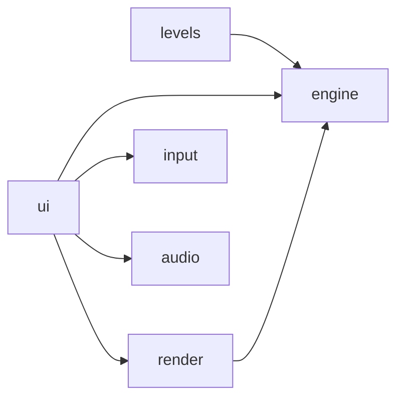

# lumen

[](https://github.com/vovaddk/lumen/actions/workflows/ci.yml)

**Route light. Mix colour. Light every receiver.**

lumen is a browser puzzle game about steering coloured beams across a grid with mirrors, splitters, filters, prisms and hue shifters. Light mixes additively, so red and green arriving at the same receiver make yellow. Every receiver wants exactly its colour, and some sensors must stay dark.

It ships 24 handcrafted levels in three chapters, and a breadth-first solver proves that every one of them is solvable and computes the minimum piece count used for stars. A level editor checks your levels with the same solver and shares them as a compact link.

**[Play it in the browser](https://vovaddk.github.io/lumen/)**



| Solving the finale with four pieces | Colour-blind mode adds shape glyphs |
| --- | --- |
|  |  |

| Level editor with solver check | Phone layout |
| --- | --- |
|  |  |

## How to play

Each level has emitters that fire light, receivers that need a colour, and a tray of pieces. Place pieces on empty floor to bend, split, filter and recolour the beams. The level is solved when every receiver gets exactly its colour and every sensor is dark.

| Action | Mouse | Touch | Keyboard |
| --- | --- | --- | --- |
| Move the cursor | | | Arrow keys |
| Place the selected piece, or turn a mirror | Click | Tap | Space or Enter |
| Remove a piece | Right-click | Long-press | Delete or Backspace |
| Turn the piece under the cursor | | | R |
| Pick a piece from the tray | Click it | Tap it | 1 to 9 |
| Undo / redo | Buttons | Buttons | Z / Y (or Ctrl+Z, Ctrl+Y, Ctrl+Shift+Z) |
| Reset the board | Button | Button | Shift+R (undoable) |
| Hint | Button | Button | H |
| Next level once solved | Button | Button | N |

Stars: three for solving at par (the solver's minimum), two for par + 1, one otherwise.

## Mechanics

Colours are 3-bit masks: red = 1, green = 2, blue = 4. Mixing is bitwise OR, filtering is AND.

| Piece | What it does | Introduced |
| --- | --- | --- |
| Wall | Stops light. Nothing can be placed on it. | 1-2 |
| Glass | Lets light through, but nothing can be placed on it. | 1-3 |
| Sensor | Must stay dark. Any light on it fails the level. | 1-4 |
| Fixed pieces | Pre-placed pieces with rivets; they cannot be moved. | 1-6 |
| Mirror `/` `\` | Reflects light 90 degrees. Turn it to switch diagonal. | 1-1 |
| Splitter | Lets light through and reflects a copy, at once. | 2-3 |
| Filter | Keeps only the channels painted on it (red, cyan, yellow, ...). | 2-4 |
| Prism | Red bends left, green goes straight, blue bends right, relative to travel. Works on any mix, so it also sorts colours. | 3-1 |
| Hue shifter | Rotates channels: red to green, green to blue, blue to red. | 3-3 |

Chapters introduce one idea at a time: Reflection (mirrors, walls, glass, sensors), Spectrum (mixing, splitters, filters, a light loop), Refraction (prisms, hue shifters, and a finale that makes white light out of a single red emitter).

## How the beam tracer works

Light is linear: the three channels never interact until they reach a receiver, where they are OR-ed together. So the tracer (`src/engine/tracer.ts`) does not follow multi-colour beams. It follows **single-channel states** `(cell, direction, channel)`, meaning "this channel is about to leave the centre of this cell in this direction".



There are at most `cells x 4 directions x 3 channels` states and each is expanded once, so **beam loops terminate by construction**: a ring of mirrors fed by a splitter, or a hue shifter inside a loop that cycles red, green and blue forever, costs a bounded number of steps. Tests cover a splitter ring, a shifter loop, a splitter lattice and a 12x12 board filled with splitters.

The trace records which channels pass each half of each cell (centre to edge). The renderer draws those half-segments once per channel with additive blending (`globalCompositeOperation = 'lighter'`), so overlapping red and green beams really do render yellow, and the same data drives the drifting photons and the colour-blind glyphs.

## How the solver works

The solver (`src/engine/solver.ts`) is a breadth-first search over **sets of placements**, one piece deeper per layer, so the first solution it finds uses the minimum number of pieces. That minimum is the level's par.



Two prunings keep the search small without losing completeness for minimum solutions:

1. **Only lit cells are candidates.** In a minimal solution every piece is hit by light (otherwise it could be removed). Ordering the pieces by when the final beams first reach them shows that each one sits on a lit cell at the moment it is added.
2. **No identity placements.** A red filter on a cell that only red light reaches, or a prism on pure green, changes nothing right now. If every remaining piece of a minimal solution were unlit or an identity, the smaller set would already solve the level, contradicting minimality.

Configurations are de-duplicated as unordered sets, so permutations are visited once. The search has a node budget and returns `solved`, `unsolvable` (the search space was exhausted, which is a proof) or `limit`.

The same solver powers three features:

- **Tests**: `solver.test.ts` solves every shipped level, checks the minimum equals the level's declared `par`, then replays the solution through the game rules (tray limits, buildable cells) to make sure it really solves the level. The 24 levels take about 1.5 seconds in total.
- **Hints**: running in a Web Worker, the solver first tries to complete the player's current board (the player's pieces become fixed base placements); if that fails, it falls back to a fresh solution and points at the first piece the player has not got right.
- **The editor**: "Check with solver" reports the par, or that the tray cannot solve the level.

In the app every search runs in a Web Worker (`ui/solver.worker.ts`, a few lines around the pure engine), so the page never blocks. Each search also has a node budget (`SOLVE_BUDGET`): 150k for shipped levels, 100k for editor checks, 25k for levels that arrive in a link. Search nodes store only their placement codes and boards are rebuilt when expanded, so memory is bounded by the budget. A test runs a worst-case 12x12 board through the 25k budget and checks it stops at the limit.

`npm run levels` prints the solver report, including one solution per level drawn as text.

## Level editor and share codes

The editor (`#/editor`) has tools for emitters (colour and direction), receivers, sensors, walls, glass and fixed pieces, plus counters for the player's tray. The board traces light live while you build. **Test play** opens the level in the game, **Check with solver** proves it solvable, and **Copy share link** produces a URL such as:

```
https://vovaddk.github.io/lumen/#/l/AQcGAwUEARUDCRgBAAEAAgtDb3JuZXIgc2hvcDg
```

The code is a small versioned binary format, base64url-encoded (`src/engine/codec.ts`):

```
[version][width][height][tileCount] {[cell][type][param]}*
[stockCount] {[kind<<3 | colour][count]}*  [nameLength] {utf-8 name}  [checksum]
```

A 7x6 level with a dozen objects encodes to about 50 characters. Share codes come from URLs, so the decoder treats them as **untrusted input**: length cap, strict alphabet, checksum, version check, range checks on every byte, no repeated cells, strict UTF-8 for the name, no trailing data, and finally the same `validateLevel` used for shipped levels (board 3-12 per side, at least one emitter and receiver, tray limits). Par is never read from a code: the board opens first, then the solver works out par in the background with the small untrusted budget and shows "Par unknown" if the budget runs out. Tests round-trip every shipped level, reject a dozen kinds of malformed code, and fuzz the decoder with 2,000 random strings to check it only ever throws `CodecError`.

## Architecture

```
src/
  engine/   pure, deterministic, zero DOM: types, colour maths, grid, pieces, tracer,
            rules (win check, stars), game moves, undo/redo history, solver, validation,
            text level parser, share-code codec. Covered by unit tests.
  levels/   the 24 levels as data, in a readable text grid format
  render/   Canvas 2D board renderer, piece and tile drawing, theme
  input/    pointer, touch and keyboard to cell-level intents
  audio/    synthesised WebAudio sound effects
  ui/       screens (level select, play, editor), solver worker, DOM helper, storage, announcements
  main.ts   hash router and app shell
scripts/
  level-report.ts   solver report for every level (`npm run levels`)
```



The engine never imports from the other folders, and ESLint forbids browser globals (`window`, `document`, `localStorage`, `navigator`) inside `engine/` and `levels/`. The level parser, tests and the Node report script all run the same engine code.

**Why no framework.** The game is a canvas plus three small panels. A dozen lines of DOM helper (`ui/dom.ts`) cover what a UI library would add, the production bundle is about 56 kB of JavaScript (20 kB gzipped), and there is no virtual DOM competing with the render loop. The trade-off is that panels re-render by rebuilding their DOM, which is fine at this size.

**Why Canvas 2D.** Additive blending, round caps and radial gradients give the glow without shaders, the board is at most 12x12, and Canvas 2D works everywhere WebGL might be disabled. The renderer only redraws while something animates; with reduced motion it draws on change only.

Levels are written as text so they are easy to review in a diff:

```ts
{
  id: '1-4',
  name: 'Keep it dark',
  par: 2,
  inventory: { mirror: 2 },
  map: [
    '.  .  .  .  .  .  @g',
    '.  .  .  .  .  .  .',
    '>g .  .  x  .  .  .',
    ...
  ],
}
```

`>g` is a green emitter facing east, `@g` a receiver that needs green, `x` a sensor, `#` a wall, `~` glass; fixed pieces are `/`, `\`, `s/`, `fr`, `p`, `h`.

## Accessibility

- **Full keyboard play**: arrow keys move a visible cursor, Space places or turns, Delete removes, number keys pick pieces, plus shortcuts for undo, redo, reset, hint and next level. Tutorial dialogs take focus and hand it back to the board.
- **Screen-reader announcements** through a polite live region: moving the cursor reads the cell ("F4: receiver needs yellow, gets red"), and every move reports what changed and how many targets are satisfied. The targets list in the side panel says the same in text. Board coordinates (A-L, 1-12) are drawn on the board to match.
- **Colour-blind mode** draws shapes on every beam and receiver: triangle for red, square for green, circle for blue, so mixes read as combinations of shapes. Colour names are always given in text too.
- **Reduced motion**: with `prefers-reduced-motion`, photons, placement and rotation tweens, receiver pulses and the win sweep are all off.
- Touch: tap to place or turn, long-press to remove; the board is sized to the viewport.
- Sound effects are synthesised with WebAudio oscillators (no audio files) and can be muted. Settings and progress live in `localStorage` and are validated when read back.

## Getting started

Requires Node 24.

```bash
npm ci
npm run dev        # http://localhost:5173/lumen/
```

## Scripts

| Script | What it does |
| --- | --- |
| `npm run dev` | Vite dev server |
| `npm run build` | Type-check and build to `dist/` (base path `/lumen/`) |
| `npm run preview` | Serve the production build |
| `npm run lint` | ESLint with `typescript-eslint` strict type-checked rules |
| `npm run typecheck` | `tsc -b` in strict mode (`noUncheckedIndexedAccess`, `exactOptionalPropertyTypes`) |
| `npm test` | Vitest unit tests |
| `npm run levels` | Solver report for every shipped level |

CI (`.github/workflows/ci.yml`) runs lint, typecheck, tests and build on Node 24. `deploy-pages.yml` publishes `dist/` to GitHub Pages on every push to `main` (set Pages to "GitHub Actions" once).

## Testing

89 tests in `src/**/*.test.ts`:

- **Tracer**: straight lines, each piece type (both mirror orientations, splitters, filters including full blocks, prism channel routing, hue shifting), walls, glass, emitter housings, receivers mixing light from several sides, fixed pieces.
- **Loops**: splitter ring, hue shifter inside a loop, splitter lattice, 12x12 splitter board; all bounded by `cells x 12` steps.
- **Rules**: colour maths, exact-colour wins, over-lit and wrong-colour receivers, lit sensors, unlit receivers, stars.
- **Codec**: round-trip of every shipped level and of every tile type with a Unicode name; rejection of empty, oversized, truncated, damaged, wrong-version, out-of-range, repeated-cell, invalid-UTF-8, bad-tray and trailing-data codes; random fuzzing.
- **Solver**: every shipped level solvable at exactly its par with a replayable solution, minimality, unsolvable proof, node budget, a worst-case 12x12 board stopping at the untrusted budget, hints that keep the player's pieces.
- **Keyboard**: board key mapping, including Shift+R reaching the reset shortcut instead of rotating.
- **Storage**: merging progress across tabs (best score per level wins, tutorials are unioned), and sanitising stored data.
- **History and moves**: undo/redo, redo branch dropped on a new move, history cap, tray limits, glass and walls not buildable, rotation and removal undone exactly.

## Roadmap

- A tighter solver for big editor levels: an admissible lower bound (receivers no beam can reach yet) to turn the breadth-first search into IDA*.
- An undo history and a "show solution" step-through in the editor.
- Cancel an in-flight solver search when the player leaves the screen (today the result is just ignored).
- Offline play as a PWA.

## License

[MIT](LICENSE) © 2026 Vova Dudnyk
